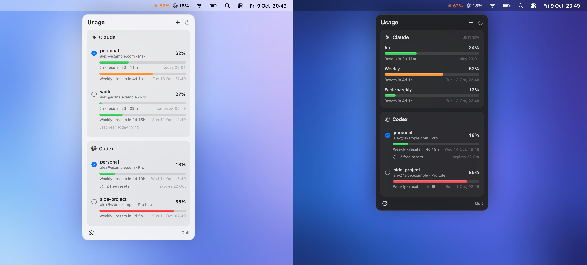

# AI Usage

Your Claude and Codex usage limits, one glance away in the macOS menu bar, and one click to
switch between your accounts.

<p align="center">
  
</p>

- **Menu bar**: the most used limit of each provider, colored only when it matters
  (orange from 50 %, red from 80 %).
- **Panel**: every limit with its countdown and exact reset time: Claude's 5-hour, weekly and
  per-model windows, Codex's windows and free resets. A provider you don't use stays out of the way.
- **Accounts**: save several Claude Code and Codex accounts, switch with a click or from the
  terminal (`ccx`, `cx`).
- **Settings** (⚙︎): open at login, appearance (automatic, light, dark), English or French.

## Install

Requires macOS 14+ and the Xcode Command Line Tools (`xcode-select --install`).
Claude Code and the Codex CLI are each optional.

```sh
git clone https://github.com/MathFreedom/ai-usage && cd ai-usage
./install.sh
```

This builds `~/Applications/AI Usage.app` and links `cx` and `ccx` into `~/.local/bin` (add it to
your `PATH` if needed). The installer doesn't touch Claude Code's or Codex's settings. Then save
the accounts you're signed in with:

```sh
ccx save    # Claude Code
cx save     # Codex
```

## Accounts from the terminal

| | Claude Code | Codex |
|---|---|---|
| List with usage | `ccx` | `cx` |
| Save the current account | `ccx save [name]` | `cx save [name]` |
| Add another account (browser sign-in) | `ccx add [name]` | `cx add [name]` |
| Switch | `ccx use <name>` | `cx use <name>` |
| Forget | `ccx rm <name>` | `cx rm <name>` |

Adding an account never signs out the active one. After a switch, restart Claude Code sessions
that were already open; `cx` restarts the Codex daemon itself (a switch from the app stops it
instead, and the next `codex` session starts it again), but the ChatGPT app and IDE extensions
need a restart.

## How it works

- **Usage** is read from the endpoints the official clients use:
  `api.anthropic.com/api/oauth/usage` for Claude, `chatgpt.com/backend-api/wham/usage` for Codex.
  Nothing is ever consumed: free resets are only displayed.
- **Credentials stay on your Mac.** Claude accounts are kept in the login Keychain
  (`ai-usage-claude:<name>`), Codex accounts in `~/.codex-accounts/` (mode 600). Inactive Claude
  accounts show their last known usage: their tokens are never refreshed in the background.
  Codex accounts show their last known usage when it can't be read (offline, for example).
- **Logos** are taken from the Claude and ChatGPT apps when installed; SF Symbols otherwise.

[`AGENTS.md`](AGENTS.md) documents the internals; changes follow [`docs/PROCESS.md`](docs/PROCESS.md)
and must pass `tools/check.sh` (builds, offline tests, secret scan).

## Upgrading from a version with the status line

Earlier versions also installed a Claude Code status line: `statusLine` in
`~/.claude/settings.json` points at `~/.claude/statusline-cache.sh`, a link into this repo that no
longer leads anywhere. After `git pull`, pick one:

1. Print the status line you had before installing (`null` if none):
   `jq .statusLine ~/.claude/settings.json.bak-ai-usage`
2. In `~/.claude/settings.json`, either:
   - **go back to it**: set what step 1 printed as `statusLine` (if it printed `null`, remove the
     status line instead, below);
   - **keep this status line**: copy it out of the repo's history, from your clone, and point
     `statusLine.command` at `~/.claude/ai-usage-statusline.sh`. The copy refuses to overwrite an
     existing file (`set -C`); if that file is already there, pick another name:
     `f=$(git show 15cf9d5:claude/statusline.sh) && (set -C; printf '%s\n' "$f" > ~/.claude/ai-usage-statusline.sh) && chmod +x ~/.claude/ai-usage-statusline.sh`;
   - **remove the status line**:
     `tmp=$(mktemp) && jq 'del(.statusLine)' ~/.claude/settings.json > "$tmp" && cat "$tmp" > ~/.claude/settings.json && rm "$tmp"`
3. Remove what it left behind:
   `rm -f ~/.claude/statusline-cache.sh ~/.claude/usage-cache.json ~/.claude/settings.json.bak-ai-usage`
   and, unless you kept this status line and want the previous one to keep running behind it,
   `rm -f ~/.config/ai-usage/statusline-chain`.

## Uninstall

If you installed a version with the status line, follow the upgrade steps above first. Turn off
**Open at Login** in the app's settings. Then quit the app and remove everything the installer and
the app created:

```sh
osascript -e 'quit app "AI Usage"'
rm -rf ~/Applications/AI\ Usage.app ~/.local/bin/cx ~/.local/bin/ccx
rm -rf ~/.codex-accounts ~/.config/ai-usage
defaults delete io.github.mathfreedom.ai-usage
```

Saved Claude accounts live in Keychain Access under `ai-usage-claude:`; delete them there.

## Disclaimer

AI Usage is an unofficial personal project, not affiliated with or endorsed by Anthropic or
OpenAI. Claude is a trademark of Anthropic, PBC; ChatGPT, Codex and OpenAI are trademarks of
OpenAI. It relies on undocumented endpoints that may change at any time. Only use accounts that
are yours, within each provider's terms.

## License

[MIT](LICENSE)
